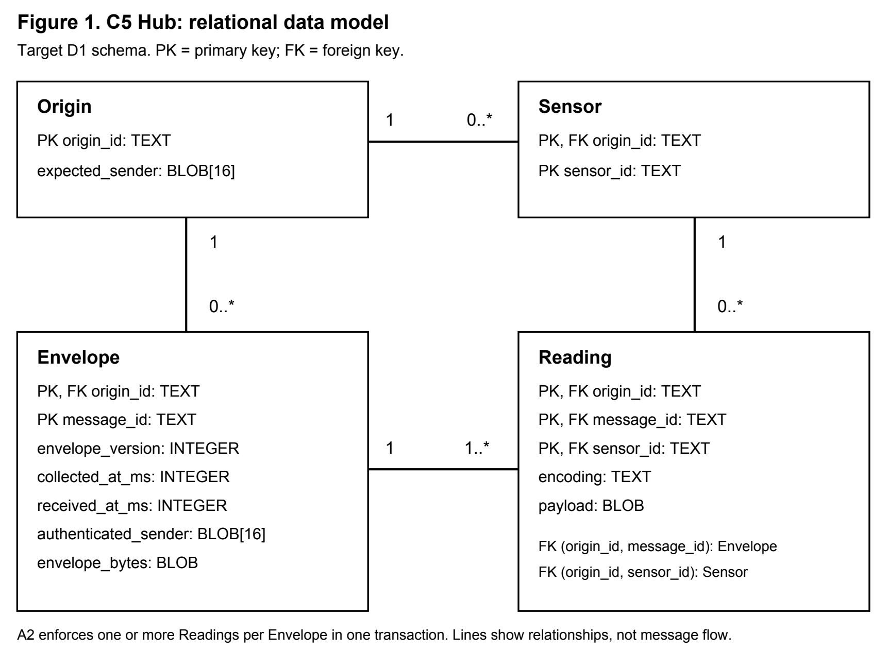

# Pulse - Detailed System Design (D1)

Assignment 6 - Detailed System Design, Part 1 (Design D1)

## 1. Header, scope, and conventions

**Project title:** Pulse - platform-independent IoT communication for resilient farm sensor networks.

**Goal statement:** Move every farm sensor reading from a field device to a trusted Hub over any available link, and keep each reading until the Hub stores it.

**Team:** Jacob Cohen, Sujal Choukse, Yatharth Bajaj. **Advisor:** Jeffrey Gundler. **Date:** October 6, 2026.

This document details the Node (C3) and Hub (C5); D2 details the Sensor Driver (C1), Edge (C2), Transport Adapter (C4), and Builder (C6).

The Node owns reliable delivery and sender checks. The Hub owns the data model and the storage transaction. Jacob owns C3. Yatharth owns C5. Sujal checks sensor formats with both owners. The shared Protobuf package defines I3, I5, and I6. It does not run as a component.

### Figure conventions

Figure 1 uses rectangles for Hub tables. Each rectangle lists the table name and its key fields. Solid lines show foreign-key relationships. Labels give the count at both ends: `1` means exactly one, `0..*` means zero or more, and `1..*` means one or more. `PK` marks a primary key. `FK` marks a foreign key. One composite key uses all marked fields together. Lines do not show message flow. The figure uses no person or hardware symbols. The SQL source gives the full constraints. The Hub transaction enforces the minimum of one Reading per Envelope.

### Basis and changes from D0

The project title, goal, component IDs, and reading key stay the same as D0 [P1]. The following changes make D0 precise.

| Item | D1 decision and basis |
| --- | --- |
| Retry limit | Retry every 30 seconds until the 3,600-second deadline. Five retries alone do not cover US-01. This changes D0's retry limit. |
| Queue key | Each field Node uses `(message_id, destination)`. This prevents one destination's receipt from removing another destination's copy. |
| Hub model | Origin, Sensor, and Envelope tables support the existing Reading key. The Hub checks duplicate content before sending a receipt. |
| Carrier and identity | Current code uses Reticulum over TCP, a 16-byte identity hash, and no Pulse TTL. D0 names UDP and a 32-byte sender key. |
| Build status | These refinements define target behavior. Current code still uses message-only queue keys, five retries, and a flat readings table [P3]. |

The queue stays in memory in D1. Outage tests keep both Nodes running. Recovery after a Node restart depends on the durable queue design in D2. A local acceptance response confirms memory admission. It does not confirm storage at the Hub.

<!-- pagebreak -->

## 2. Data model, the D1 diagram

Figure 1 details C5. All four tables use SQLite on the Hub host.



### Structural decisions

| Decision | Reason and requirement |
| --- | --- |
| Envelope is an entity | One publication groups samples into one commit and one receipt. Its stored content identifies conflicting retries. US-01, US-02; I6, I7. |
| Sensor is an entity | An origin can use one sensor across many messages. An encoding belongs to each Reading because formats can change. US-04. |
| One-to-many links | Each Envelope has one Origin. Each Reading has one Envelope and one Sensor. Reading joins their histories. US-02, US-04. |
| Relational store | Keys, foreign keys, and transactions protect a complete publication. A plain file needs custom checks and recovery. US-02, US-05. |

An Origin represents a configured device name. Its expected sender hash binds that name to one identity. The Node trust table remains the authority. The Hub imports the same binding before it accepts remote data. One identity can own several Origin names. Key changes require a controlled configuration update; D1 does not permit two active keys for one Origin.

<!-- pagebreak -->

### Key attributes, constraints, and indexes

| Table | Key attributes and rules |
| --- | --- |
| Origin | `origin_id: TEXT`, PK; `expected_sender: BLOB`, exactly 16 bytes. The name contains 1-64 ASCII characters. The Origin row exists before delivery. |
| Sensor | `(origin_id, sensor_id): TEXT`, PK; `origin_id` is an FK. Sensor rows exist before delivery. Both names contain 1-64 ASCII characters. |
| Envelope | `(origin_id, message_id): TEXT`, PK; `origin_id` is an FK. The stored fields are `envelope_version: INTEGER = 1`, `collected_at_ms: INTEGER >= 0`, `received_at_ms: INTEGER > 0`, `authenticated_sender: BLOB` of 16 bytes, and `envelope_bytes: BLOB`. |
| Reading | `(origin_id, message_id, sensor_id): TEXT`, PK. The first two fields form an FK to Envelope. `(origin_id, sensor_id)` forms an FK to Sensor. The Hub stores `encoding: TEXT` and `payload: BLOB` unchanged. |

All fields are required. `collected_at_ms = 0` means the sensor time is unknown. All other times use UTC milliseconds since the Unix epoch. The receiver clock supplies `received_at_ms`. Arrival time does not replace collection time. Payload units belong to the decoder contract. For example, the moisture value is a fraction from 0 to 1.

| Index | Lookup and reason |
| --- | --- |
| Envelope PK | Find a duplicate by origin and message in logarithmic time. US-02; I7. |
| Reading PK | Enforce D0's unique sample key and fetch a whole envelope. US-02, AC-01.2. |
| Sensor PK and Origin PK | The keys support sensor and identity checks. US-04, US-05. |
| Envelope `(origin_id, collected_at_ms, message_id)` | Read a device's time range without a full scan. The final field resolves equal times. US-01. |
| Reading `(origin_id, sensor_id, message_id)` | Fetch sensor history and check references before sensor removal. US-04. |

Our planning period is 30 days. The Hub retains each Envelope and its Readings for at least 3,600 seconds after receipt. It retains duplicate keys throughout the retry period. D2 defines removal and backup rules. SQLite uses `foreign_keys=ON`, `journal_mode=WAL`, `synchronous=FULL`, and a 5,000 ms busy timeout. FULL adds a disk sync at each commit in WAL mode [W1].

### C3 state model

`Publication` holds an immutable envelope and one unique `message_id: string` for the Node. `Delivery` holds one destination's state. One Publication has `1..*` Deliveries; each Delivery has exactly one Publication. The Delivery key is `(message_id, destination)`. Its fields are `expected_peer: bytes[16]`, `ack: AckMode`, `attempts: uint32`, `accepted_at: Instant`, `deadline: Instant`, `next_attempt: Instant`, `wrapper: bytes`, and `notify: set<uint64>`. `Instant` is a monotonic local time and has no wire format.

The Node uses a hash map for Deliveries and one queue for new work. Capacity includes queued and waiting reliable Deliveries. The field limit is 128 Deliveries. Best-effort traffic uses a separate 64-item queue. A full reliable queue rejects new work. A full best-effort queue removes its oldest item and increases `dropped`. Durable queue storage remains part of D2.

<!-- pagebreak -->

## 3. Core algorithms

### A1. Retry delivery until the requested receipt or expiry

**1. Purpose.** A1 keeps reliable publications during link outages. It prevents an early receipt from deleting data before the Hub commit. It implements US-01 and US-02 through I3, I4, I5, and I6.

**2. Inputs and outputs.** Inputs are `PublishRequest`, verified `StatusUpdate`, `now: Instant`, and configured limits. Section 5 gives exact wire types. Output is `Result<bool, ErrorDetail>`, zero or more signed packet sends, and `StatusEvent` values. Status values are `RECEIVED`, `STORED`, `EXPIRED`, or `FAILED`.

**3. Procedure and complexity.** The Node checks the request and encodes its signed wrapper. It rejects remote wrappers above 383 bytes. It rejects duplicate message IDs with different envelope bytes. It admits one Delivery per destination. A repeat of the same pending request reuses the Delivery without extending its deadline. The Node adds the caller to its notification set. The first attempt occurs immediately. The deadline is acceptance plus 3,600 seconds.

At each one-second tick, the Node checks expiry before sending. It expires Deliveries whose deadline is at or before now. It sends each remaining due wrapper once. It increases the attempt count and sets the next attempt to now plus 30 seconds. A send error keeps the Delivery. A delayed tick sends once; it does not send a burst of missed attempts. The interval is a minimum; the carrier can delay a send.

The Node checks each remote receipt's signature and expected peer. It resolves the destination from that peer's configured service. For `ACK_STORED`, `RECEIVED` does not remove the Delivery. A valid `STORED` removes only that destination's Delivery. For `ACK_RECEIVED`, a valid `RECEIVED` or `STORED` completes it. A remote `FAILED` or `EXPIRED` does not prove storage. The Node keeps an `ACK_STORED` Delivery until local expiry. It deletes a Publication only when it has no Deliveries.

Admission and receipt lookup take expected `O(1)` plus `O(B)` encoding and signature work. A tick takes `O(Q + D*B)`, where Q is pending Deliveries, D is due sends, and B is wrapper bytes. Memory takes `O(Q*B)` plus notification sets. The scan uses library containers; it does not require custom sorting.

| Planning size | Estimated work and effect |
| --- | --- |
| One field Node | One message per 60 seconds gives at most 60 pending messages in one hour, with one destination. A tick checks about 60 entries. |
| 100 times that load | A shared test Node holds 6,000 Deliveries. A tick checks 6,000 entries. Its test capacity is 8,192. This does not fit the field limit. |
| Storage estimate | At the 383-byte wrapper limit, 60 wrappers use about 23 KB; 6,000 use about 2.3 MB, before container overhead. |

**4. Why this algorithm.** A simple scan suits the bounded field queue. A minimum heap reduces idle checks to `O(log Q)` updates but adds cancellation state. Stop-and-wait blocks other sensors during an outage. Five retries end after about 150 seconds and cannot cover US-01. A heap becomes an option if measured scheduler cost limits performance at 100 times load. Radio airtime can dominate these CPU costs.

**5. Edge cases.** An empty queue sends nothing. Equal retry times each get one send. Their order does not affect storage. Repeated receipts after completion do nothing. A wrong peer, bad signature, or unknown message does not remove data. Full capacity returns `QUEUE_FULL` without removal. At exactly the deadline, expiry wins. With several services on one peer, each destination uses a distinct message ID because v1 receipts omit destination. Node restart loses memory state; persistent storage remains part of D2.

<!-- pagebreak -->

### A2. Check and commit a complete envelope once

**1. Purpose.** A2 converts a verified delivery into one stored row per sensor. It sends `STORED` only after a complete commit. It implements US-02, US-04, and US-05; AC-01.1 to AC-01.3; I6 and I7.

**2. Inputs and outputs.** Input is `DeliveryEvent{destination: string, message: PulseEnvelope, authenticated_sender: bytes[16]}` plus `receivedAtMs: int64 > 0`. Output is `StoreResult = STORED | DUPLICATE` or `StoreError`. `StoreError` is `INVALID_ENVELOPE | UNKNOWN_SENSOR | UNSUPPORTED_ENCODING | INVALID_PAYLOAD | IDENTITY_MISMATCH | CONFLICTING_DUPLICATE | STORAGE_ERROR`. These are internal codes, not new Protobuf enum values. Success causes `AckRequest{message_id, status: STORED, detail: ""}`. Failure causes a log entry and no receipt.

**3. Procedure and complexity.** The Hub checks the envelope fields and sender binding. It checks each sensor against the Sensor table. It rejects repeated sensor IDs. The decoder registry selects a library parser for each encoding. If any sample fails validation, the Hub rejects the whole envelope.

The Hub encodes the parsed envelope with the pinned Java Protobuf codec. It stores this representation as `envelope_bytes`. This uses the same codec for every comparison; it does not compare arbitrary Protobuf field order on the network. The Hub starts one `BEGIN IMMEDIATE` transaction. It looks up `(origin_id, message_id)`. If the key exists, it compares stored bytes and sender with the new values. A match returns `DUPLICATE`. A difference causes rollback and returns `CONFLICTING_DUPLICATE`. A retry must keep sample order and payload bytes unchanged.

For a new key, the Hub inserts one Envelope and all its Readings. It commits the transaction, returns `STORED`, and sends the receipt. A failed commit rolls back all new rows. A failed receipt send leaves committed rows unchanged. The next matching retry returns `DUPLICATE` and sends the receipt again. The PK check inside the transaction handles concurrent writers. The transaction reports data conflicts rather than ignoring them.

Let S be samples, B be envelope bytes, R be stored Readings, and E be stored Envelopes. Checks take `O(B + S)` with a set for sensor IDs. Indexed inserts take `O(S log R + log E)`. Memory takes `O(B + S)`. Disk sync adds storage latency; this formula does not predict elapsed time.

| Planning size | Estimated work and effect |
| --- | --- |
| Initial farm | 10 devices, one sample per minute: 14,400 Readings/day and 432,000 in 30 days. Average intake is 0.167 envelopes/second. |
| 100 times that load | 1,000 devices: 1,440,000 Readings/day and 43,200,000 in 30 days. Average intake is 16.67 envelopes/second. |
| Index and disk estimate | `log2(R)` rises from about 19 to 26. A planning allowance of 1 KB per sample gives about 432 MB or 43.2 GB. |

These are sizing assumptions, not measured throughput or known farm inventory. SQL B-trees use page fanout, so log2 values only compare growth. WAL files, backups, and free space add to the disk allowance. The 100-times case needs a host storage check and a commit benchmark. It does not establish that one LoRa channel carries that load.

**4. Why this algorithm.** A transaction prevents partial envelopes. A primary key and full content comparison give persistent duplicate checks. An in-memory set loses history after restart. A separate lookup followed by an unlocked insert races with another writer. A receipt before commit loses data after a crash. Generated Protobuf bytes avoid a custom hash or canonical JSON scheme.

**5. Edge cases.** The Hub rejects empty samples, unknown encodings, empty sensor IDs, negative times, and repeated sensor IDs. Equal times remain separate messages. Queries order results by time, then message ID. Unknown collection time stays zero. An identical retry returns `DUPLICATE`. Changed payload under the same key returns a conflict. Unapproved remote identities never reach storage. Disk full, busy timeout, and a failed commit send no receipt. A crash before commit leaves no new envelope; a crash after commit permits a matching retry.

<!-- pagebreak -->

## 4. Build-versus-reuse decisions

The selected versions match our current project dependencies. `Cargo.lock` pins Rust dependencies. `gradle/libs.versions.toml` pins Java dependencies. Project code uses the Pulse proprietary course license [P3]. We use upstream license files and documentation for these decisions. This table covers the significant parts of C3 and C5.

| Piece | Build or reuse; license | Maturity, performance, and fit |
| --- | --- | --- |
| Delivery lifecycle | Build; Pulse course license | Project-specific retry and receipt rules. Bounded scans suit 60 pending messages. Library containers provide the basic operations. |
| Atomic storage and duplicate rules | Build; Pulse course license | The key, transaction order, and content conflict rule belong to Pulse. SQLite provides transaction recovery. |
| Decoder registry and sensor checks | Build; Pulse course license | US-04 needs a small encoding-to-decoder map. Each decoder defines its fields and units. |
| Local RPC and framing | Build the contract; Pulse course license | I3/I6 need a shared small frame, explicit errors, and Rust/Java vectors. Generated codecs encode the body. |
| Async I/O and timers | Reuse Tokio 1.53.1; MIT [W2] | Maintained runtime with documented support policy. Bounded channels and timers fit OS hosts. ESP32 runtime fit remains a D2 task. |
| Protobuf codecs | Reuse prost 0.13.5, Apache-2.0; protobuf-java 4.32.1, BSD-3-Clause [W3, W4] | Established schema tools produce compact binary messages. Shared vectors check language agreement. Generated bindings preserve stable field numbers. |
| Signature and verification | Reuse ed25519-dalek 3.0.0; BSD-3-Clause [W5] | Established library family; version 3 matches the SDK. The library signs exact bytes. D2 covers board measurements. |
| Network stack | Reuse reticulum-sdk 2.3.4; MIT [W6] | Small upstream project; direct LoRa support is experimental. Our dependency pins this version. It provides paths and encryption. Hardware and Python interoperation remain required checks. |
| Database engine and driver | Reuse SQLite, public domain; Xerial 3.49.1.0, Apache-2.0 and BSD-2-Clause notices [W7, W8] | Mature embedded database; maintained JDBC driver. One writer fits initial intake. Host disk speed determines FULL commit latency. |
| Message IDs | Reuse uuid 1.26.0; MIT OR Apache-2.0 [W9] | Established UUID parser and generator. Version 4 avoids a shared ID service. Changed data under the same ID causes a conflict. |
| JSON decoding | Reuse Gson 2.13.1; Apache-2.0 [W10] | Maintenance mode is sufficient for JSON parsing. The decoder uses strict parsing and explicit field checks. Adding it to runtime is a D1 target; it is a test dependency today. |
| Time and scheduling | Reuse Rust `Instant`, Java `System.currentTimeMillis`, and library timers; Rust MIT/Apache-2.0, OpenJDK GPL-2.0 with Classpath Exception [W11, W12] | Standard APIs avoid a custom date parser. Monotonic time controls retries. Epoch milliseconds label readings. No textual date input is needed. |

Our distribution retains the required dependency licenses and notices. The Pulse license does not replace dependency licenses. D1 selects software already present in the project where possible. A small upstream project has less support than SQLite or Protobuf; the SDK version pin and interoperation checks address that risk.

<!-- pagebreak -->

## 5. API contract

### Transport, session, and common types

I3 and I6 use persistent TCP on `127.0.0.1:4401` by default. Configuration can select another loopback port from 1 to 65,535. One frame contains a 4-byte unsigned big-endian body length and one Protobuf `RpcEnvelope`. Body length is 1 to 1,048,576 bytes. The Node checks the length before allocating the body. A bad length closes the connection. These methods use protocol error codes, not HTTP status codes.

The common wrapper is `RpcEnvelope{protocol_version: uint32 = 1, request_id: uint64, op: Operation, body: oneof}`. A request uses a required ID from 1 to 2^64-1, unique among that connection's pending requests. A response echoes that ID. An event uses ID zero. `op` and `body` must agree. Proto3 defaults do not make an application-required value optional.

| Type or field | Exact rule |
| --- | --- |
| `Name` | Required ASCII string, 1-64 characters, using letters, digits, `_`, or `-`. Applies to origin, sensor, service, and destination names. Service `node` is reserved. D1 uses service names, not arbitrary hashes. |
| `message_id` | Required canonical lowercase UUID v4 string, 36 characters. Retries keep it unchanged. Within one Node it identifies one immutable Publication. |
| `PulseEnvelope` | `{envelope_version:uint32, message_id:string, origin_id:string, collected_at_ms:int64, samples:list<SensorSample>}`. Version is 1. Origin is Name. Time is optional, 0 when unset; otherwise 1 to 2^63-1 UTC milliseconds. |
| `SensorSample` | `{sensor_id:string, encoding:string, payload:bytes}`. Sensor is Name and is unique within the envelope. Encoding is required, 1-128 ASCII characters, and names an installed decoder. |
| Samples and payload | Required list with 1-16 samples. Each payload contains 1-262,144 bytes. The total local frame must fit the frame limit. Remote publication also requires its complete signed wrapper to fit 383 bytes. |
| `AckMode` | `ACK_NONE=0`, `ACK_RECEIVED=1`, `ACK_STORED=2`. Optional; default is `ACK_NONE`. Other values are invalid. Farm telemetry explicitly requests `ACK_STORED`. |
| `Response` | Success: `{ok:true, error:absent, health:absent}`; HEALTH adds HealthStatus. Failure: `{ok:false, error:{code:ErrorCode,message:string}, health:absent}`. The message explains the cause; callers use the code. |

I5 carries `TransportPacket{payload:bytes, sender_identity:bytes[16], signature:bytes[64]}`. The payload contains `SignedPayload{ack:AckMode, body:data(bytes) | status(StatusUpdate)}`. Data bytes encode one PulseEnvelope. The signature covers the exact payload bytes. The configured public identity contains 64 bytes, shown as 128 hex characters. The 16-byte hash refers to that identity; it is not the full public key. Reticulum owns the route and hop limit [P3].

The 383-byte cap comes from the pinned SDK's encrypted single-packet limit. It includes the whole Pulse wrapper. A 1 MiB local frame does not imply a 1 MiB radio packet. Oversize remote data returns `INVALID_MESSAGE`; D2 can define fragmentation if required.

<!-- pagebreak -->

### Key operations on C3

| Method | Inputs, required values, and limits | Output and errors |
| --- | --- | --- |
| `PUBLISH` / I3 | Required `destination:Name`, `message:PulseEnvelope`. Optional `ack:AckMode=ACK_NONE`, `want_acceptance:bool=false`. Sender origin must match the local configured origin. | Success returns Response if acceptance is true. Failure always returns Response. `INVALID_MESSAGE`: bad fields, conflicting pending ID, unsupported enum, or oversize wrapper. `SERVICE_UNAVAILABLE`: no configured provider. `QUEUE_FULL`: reliable capacity is full. `UNAUTHORIZED`: origin binding fails. |
| `SUBSCRIBE` / I6 | Required `service:Name`; it must name a service allowed for this local component. Repeat registration on the same connection has no extra effect. Only one active Hub consumer owns a storage service. | Success returns Response. Deliveries then use Event. `INVALID_MESSAGE`: invalid or reserved service. `SERVICE_UNAVAILABLE`: another consumer owns it. `UNAUTHORIZED`: the component cannot host it. |
| `ACK` / I6 | Required `message_id:string` under the UUID rule; required `status:DeliveryStatus=STORED`. Optional `detail:string=""`, 0-256 UTF-8 bytes. The calling connection must own the service's pending storage delivery. | Success returns Response and causes a signed remote storage receipt. `INVALID_MESSAGE`: unknown waiter, non-STORED status, or bad fields. `UNAUTHORIZED`: another connection attempts the receipt. A lost remote receipt triggers a new delivery; its new waiter permits another ACK. |
| `HEALTH` / I3 or I6 | Required empty `HealthRequest{}`; no parameters. Wrapper version and request ID rules still apply. | Success returns Response with HealthStatus. `INVALID_MESSAGE`: version or operation/body mismatch. A closed connection yields a client I/O error. |

These validation and ownership rules are target D1 rules. Current code does not enforce every name limit, local origin binding, or ACK connection check. `ACK` currently accepts other statuses. These checks form part of our D1 design [P3]. Loopback restricts network access; it does not authenticate every local process. The first deployment uses one trusted service account and protected configuration files.

### Key method inside C5

`ReadingStore.store(envelope:PulseEnvelope, authenticatedSender:bytes[16], receivedAtMs:int64)` returns `StoreResult = STORED | DUPLICATE`. All arguments are required. The limits match the common types. `receivedAtMs` is 1 to 2^63-1 UTC milliseconds. A2 defines the checks and transaction order. The method generates comparison bytes from the parsed envelope with the pinned Java Protobuf codec.

| Internal error | Cause and caller action |
| --- | --- |
| `INVALID_ENVELOPE` | A field, count, time, or duplicate sensor fails a rule. The Hub logs the error and sends no receipt. |
| `UNKNOWN_SENSOR` / `UNSUPPORTED_ENCODING` / `INVALID_PAYLOAD` | A sensor is not configured, a decoder is absent, or its parser/check fails. The Hub rejects the whole envelope. |
| `IDENTITY_MISMATCH` / `CONFLICTING_DUPLICATE` | The identity binding fails, or the same key carries different bytes. The Hub keeps committed data and sends no receipt. |
| `STORAGE_ERROR` | SQLite returns busy timeout, disk full, or another transaction error. The Hub rolls back and sends no receipt. The origin retries until expiry. |

The current Java method returns Outcome and throws SQLException. The D1 method adds the listed checks and internal errors. These errors stay inside C5; they do not add unassigned wire enum values.

<!-- pagebreak -->

### Events, status binding, and error recovery

| Output | Exact shape, units, and conditions |
| --- | --- |
| `DeliveryEvent` / I6 | `{destination:string, message:PulseEnvelope, authenticated_sender:bytes}`. Destination is the local service hash. Sender is exactly 16 bytes for remote data or empty for local data. C5 accepts an empty sender only for a configured local origin. |
| `StatusUpdate` / I5 | `{message_id:string, status:DeliveryStatus, detail:string}`. Detail has at most 256 UTF-8 bytes. A signed expected peer supplies it. Completion requires a matching peer and pending service. |
| `StatusEvent` / I3 | `{message_id:string, status:DeliveryStatus, detail:string}`. `RECEIVED=1`, `STORED=2`, `EXPIRED=3`, `FAILED=4`. Zero is invalid. Status has no numeric unit. |
| `HealthStatus` | `{inventory_id:string, boot_id:string, uptime_seconds:uint64, component:string, queue_depth:uint32, dropped:uint64, last_contact_ms:int64}`. Inventory is Name; boot ID is UUID v4; component is `node`. Uptime counts seconds. Queue depth counts pending Deliveries, including waiting items. Dropped counts best-effort removals since boot. Contact is epoch milliseconds, zero before any verified peer contact. |

For local deliveries, C5 resolves an empty sender to the configured local identity before storage. The schema always stores a 16-byte identity hash. Collection and receipt times remain distinct. Status events omit destination in v1. Therefore, the Edge assigns distinct IDs to different destinations when one peer provides several services. A later schema can add explicit destination binding.

| Error code or failure | When it occurs | Caller response |
| --- | --- | --- |
| `INVALID_MESSAGE=1` | A supported frame has invalid Protobuf, version, operation/body, or application fields. | The caller corrects the request before retrying. A malformed body gets request ID zero if no ID can be read. |
| `SERVICE_UNAVAILABLE=2` | A destination lacks a provider or the storage service has another active owner. | The caller retries when the configured service becomes available. |
| `QUEUE_FULL=3` | Pending reliable Deliveries reach capacity. | The caller retains the sample and retries admission later. The Node does not own a rejected sample. |
| `UNAUTHORIZED=4` | A readable local request fails an origin, service, or ACK ownership check. | The caller corrects its configuration or identity before retrying. |
| Invalid remote sender | Peer is unknown, signature is bad, or origin/service binding fails. | Receiver drops and logs the packet. It sends no trusted negative receipt. This implements AC-01.3 without replying to an untrusted sender. |
| Invalid length or closed stream | Zero/oversize frame, truncated stream, or I/O failure. | The client reconnects after 100 ms and doubles the delay to a 5,000 ms cap. It subscribes again. No event replay exists on the connection. |

A valid `STORED` is the only success that proves Hub storage for `ACK_STORED`. Expiry means storage is unconfirmed; it does not prove that the Hub has no copy. A missing receipt after commit can produce this result. The Node reports the result so the technician can investigate.

**Versioning.** `protocol_version` versions local RPC; `envelope_version` versions data; both start at 1. Compatible changes add optional Protobuf fields and preserve existing field numbers. Changing a field type, required rule, receipt meaning, or supported identity width breaks the contract. Such a change requires a version increase and coordinated peer upgrade. D0's identity-width change needs no migration of deployed farm devices because D0 is a design baseline. Future deployed v1 changes require a migration. A new sensor with an installed decoder does not require a new envelope version.

<!-- pagebreak -->

### Example request and response

The example shows Protobuf JSON notation for readability. The wire uses Protobuf bytes with the length prefix. Bytes use base64. JSON uses strings for 64-bit integer fields. The sample payload decodes to `{"moisture":0.42}`. Moisture uses a fraction, not a percentage.

```json
{
  "protocolVersion": 1,
  "requestId": "17",
  "op": "PUBLISH",
  "publish": {
    "destination": "hub-main",
    "message": {
      "envelopeVersion": 1,
      "messageId": "11111111-2222-4333-8444-555555555555",
      "originId": "field-01",
      "collectedAtMs": "1788912000000",
      "samples": [{
        "sensorId": "soil-1",
        "encoding": "application/json",
        "payload": "eyJtb2lzdHVyZSI6MC40Mn0="
      }]
    },
    "ack": "ACK_STORED",
    "wantAcceptance": true
  }
}
```

```json
{
  "protocolVersion": 1,
  "requestId": "17",
  "op": "RESPONSE",
  "response": { "ok": true }
}
```

After the Hub commits, the field Node sends this event to the Edge.

```json
{
  "protocolVersion": 1,
  "requestId": "0",
  "op": "EVENT",
  "event": { "status": {
    "messageId": "11111111-2222-4333-8444-555555555555",
    "status": "STORED",
    "detail": ""
  } }
}
```

An admission failure instead returns `response:{ok:false,error:{code:QUEUE_FULL,message:"reliable outbound queue full"}}` under request ID 17. Acceptance and `STORED` remain separate results.

<!-- pagebreak -->

## 6. Technology choices with justification

### Database: SQLite through Xerial JDBC

Yatharth uses SQL and PostgreSQL in his recorded work; Sujal uses SQL and database checks [P4]. Jacob has Java experience. SQLite uses public-domain terms; Xerial supplies Apache-2.0 and BSD notices [W7, W8]. SQLite has detailed transaction documentation, and Xerial maintains releases for SQLite changes. One writer, primary-key lookups, and WAL suit the assumed 0.167 envelopes/second; the 100-times case depends on measured FULL commit performance. The database runs on the local Hub without a server subscription. We pass over PostgreSQL because a separate database service adds setup for the initial farm. PostgreSQL remains an option if measured writer or storage limits require it.

### Backend: Rust Node with Tokio; Java 21 Hub

Jacob has production experience with Rust, C++, Java, and Linux. Yatharth has experience with Python, TCP/IP, and SQL; Java Hub ownership adds a learning task [P4]. Rust uses MIT/Apache-2.0, Tokio uses MIT, and OpenJDK uses GPL-2.0 with the Classpath Exception [W2, W11, W12]. Rust, Tokio, and OpenJDK have public documentation and maintained toolchains. Rust suits bounded packet state; a small Java consumer can validate and commit the initial intake. The JVM stays on the Hub, not the ESP32. Both programs run on existing Linux hosts without a paid backend service. We pass over a Spring service because C5 needs a local consumer, not a web server. We also pass over a Python Node to preserve Jacob's Rust work and the shared Rust libraries.

### Front end: command-line tools and logs for D1

Jacob has Linux and shell experience. Sujal and Yatharth have React experience if a later dashboard needs a web interface [P4]. Pulse tools use the course license; the selected Rust/Java libraries keep their own licenses. Standard terminal tools and logging APIs have established documentation. Text output adds little work to the delivery path and needs no browser on field hardware. The technician uses the local host; no web hosting cost applies. We defer a React dashboard because US-01 to US-05 require delivery, configuration, and trust checks rather than a screen. D2 can define a separate dashboard without placing it inside the transport layer.

### Messaging and hardware: Protobuf, Reticulum, and ESP32-S3 target

Jacob's Rust and networking work supports the Node; Yatharth's industrial TCP/IP work supports bench tests. Sujal owns the sensor and hardware checks [P1, P4]. prost uses Apache-2.0, protobuf-java uses BSD-3-Clause, and reticulum-sdk uses MIT [W3-W6]. Hardware has a purchase cost, not a software license. Protobuf has broad language support; the SDK has a smaller upstream group and experimental direct LoRa support. Compact bytes and a 383-byte wrapper cap suit low-rate messages; radio settings, RAM, and energy need board measurements. We use our existing ESP32-S3 boards and LoRa board. Our first tests use Reticulum over TCP. We pass over MQTT with a central IP broker because it adds an IP service to the field path. ESP32 firmware and any RNode fallback remain D2 choices, not proven D1 results.

<!-- pagebreak -->

### Hosting: local Linux host with systemd

Jacob has Linux deployment experience; Yatharth has database and industrial host experience [P4]. Linux uses GPL-2.0, and systemd uses LGPL-2.1-or-later for its main code [W13, W14]. Pulse runs as separate programs under these host tools. Linux and systemd have established operational documentation. Independent processes restart separately; local SQLite avoids network delay during commits. Restart still loses the current Node's in-memory queue. We use an existing laptop or Linux host for the prototype, with no cloud fee. A farm host needs reliable power and disk space. We pass over cloud-only hosting because farm internet loss must not stop local collection. The course constraints state $200; an advisor record states $1,000 [P5, P6]. D1 uses the smaller allowance and requires no new purchase.

### Project sources

- **P1:** `documents/sd1/assignments/assignment-5/D0_High_Level_Design.md`, with its original figure sources. D0 provides the component and interface baseline.
- **P2:** `User_Stories.md`: US-01 to US-05, UC-01, and AC-01.1 to AC-01.3.
- **P3:** The sibling `monorepo`, commit `c845c4e`, including: `node/src/buffer.rs`, `node/src/node.rs`, `node/src/rpc.rs`, `hub/.../ReadingStore.java`, `HubMain.java`, `DecoderRegistry.java`, and `common/protocol/proto/pulse/v1/*.proto`. Dependency sources: `Cargo.toml`, `Cargo.lock`, `gradle/libs.versions.toml`, `MODULE.bazel`, and `LICENSE`.
- **P4:** The three biographies in `documents/sd1/assignments/assignment-1/`. Team experience and skills.
- **P5:** `documents/sd1/assignments/assignment-3/Constraints_Essay.md`: $200 course budget and existing board inventory.
- **P6:** `docs/meetings/2026-09-11-first-advisor-meeting.md`: desktop-first plan, board tests, and the separate $1,000 allowance.

### External sources and license checks

Dependency documentation and license sources follow.

| ID | Source and supported decision |
| --- | --- |
| W1 | [SQLite WAL](https://www.sqlite.org/wal.html): commit sync and single-writer behavior. |
| W2 | [Tokio](https://github.com/tokio-rs/tokio): runtime support and MIT license. |
| W3 | [prost](https://github.com/tokio-rs/prost): generated Rust codecs and Apache-2.0 license. |
| W4 | [Protobuf](https://github.com/protocolbuffers/protobuf): schema tools; [license](https://github.com/protocolbuffers/protobuf/blob/main/LICENSE). |
| W5 | [ed25519-dalek](https://github.com/dalek-cryptography/curve25519-dalek/tree/main/ed25519-dalek): signature implementation. Pinned 3.0.0 manifest states BSD-3-Clause. |
| W6 | [Reticulum SDK](https://github.com/ReticulaLabs/reticulum-sdk): MIT terms and experimental direct LoRa support. Pinned 2.3.4 packet source defines the 383-byte limit. |
| W7 | [SQLite copyright](https://www.sqlite.org/copyright.html): public-domain terms. |
| W8 | [Xerial JDBC](https://github.com/xerial/sqlite-jdbc): maintenance, supported hosts, and license files. |
| W9 | [uuid](https://github.com/uuid-rs/uuid): UUID generation and MIT/Apache-2.0 choice. |
| W10 | [Gson](https://github.com/google/gson): maintenance mode and Apache-2.0 license. |
| W11 | [Rust licenses](https://rust-lang.org/policies/licenses/): MIT/Apache-2.0 terms. |
| W12 | [OpenJDK license](https://github.com/openjdk/jdk/blob/master/LICENSE): GPL-2.0 with the Classpath Exception. |
| W13 | [Linux license](https://www.kernel.org/doc/html/latest/process/license-rules.html): GPL-2.0 license rule. |
| W14 | [systemd license](https://github.com/systemd/systemd/blob/main/README): main-code LGPL-2.1-or-later rule and exceptions. |
