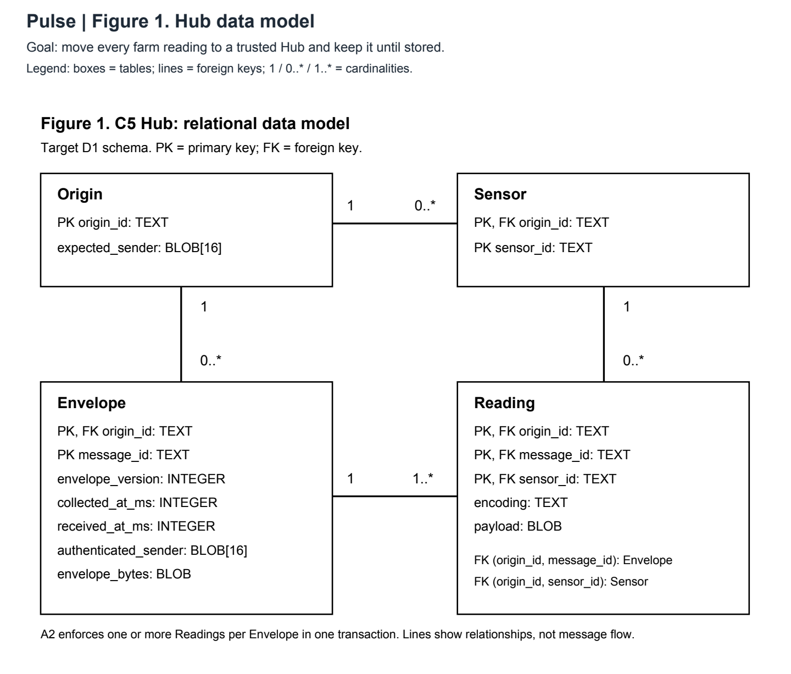
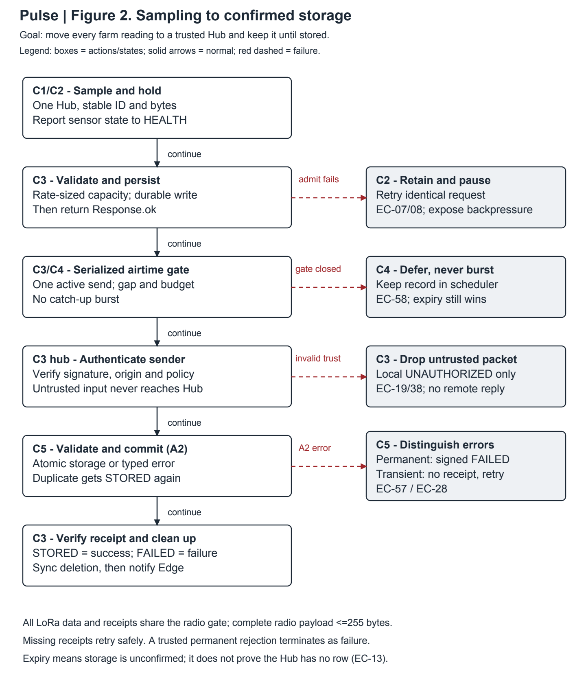
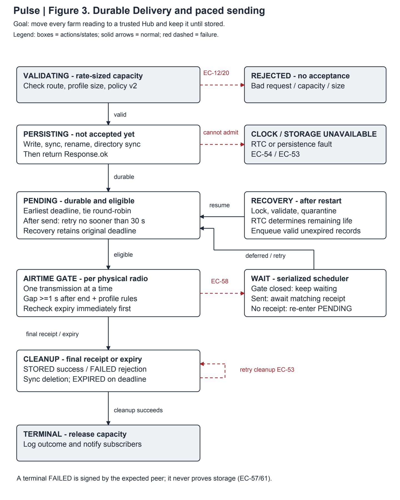
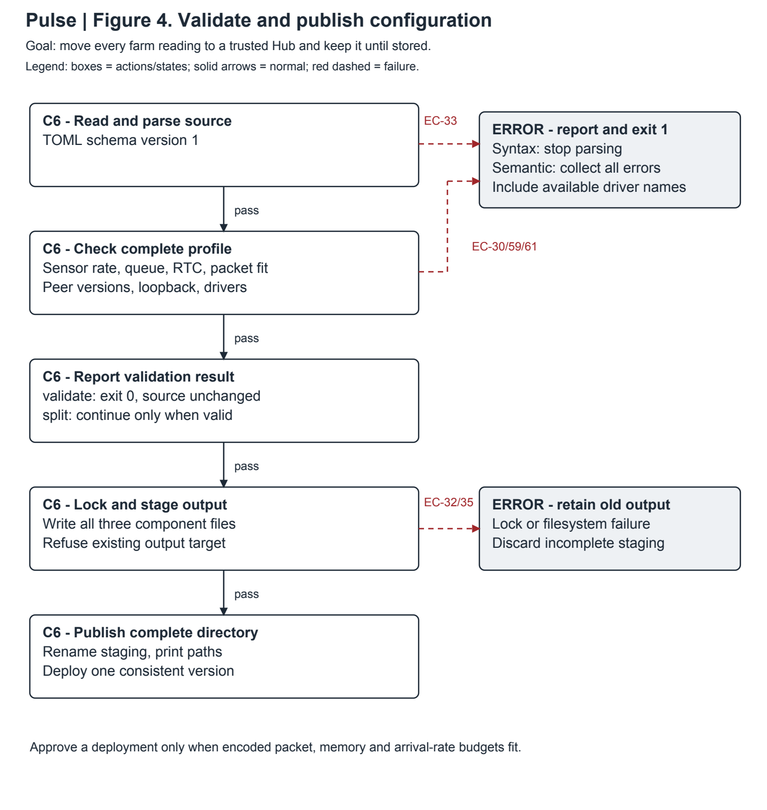

# Pulse - Detailed System Design (D2)

Assignment 7 - Detailed System Design, Part 2 (D2) | October 14, 2026

**Team:** Jacob Cohen, Sujal Choukse, Yatharth Bajaj. **Advisor:** Jeffrey Gundler.

## 1. Header, conventions, and D2 overview

**Project title:** Pulse - platform-independent IoT communication for resilient farm sensor networks.

**Goal statement:** Move every farm sensor reading from a field device to a trusted Hub over any available link, and keep each reading until the Hub stores it.

Pulse collects farm sensor readings, carries them across an intermittent link, and stores them at a local Hub. The field Node keeps admitted readings until the Hub confirms storage, rejects the envelope permanently, or the delivery deadline expires. A successful local publish means the Node has accepted responsibility; only `STORED` proves that the Hub committed the reading.

D0 named six components and nine interfaces. D1 detailed the Node's retry algorithm (A1), the Hub's storage algorithm (A2), and the shared RPC contract. D2 finishes the Sensor Driver, Edge, Transport Adapter, and Builder. It also adds durable delivery storage, Hub maintenance, and the authentication, notification, configuration, and logging rules.

D2 is the Assignment 7 update to the Assignment 4 design-diagram collection. D1 was Assignment 6; D0 keeps its original header.

**Design basis.** This document follows the D0, D1, user stories, constraints essay, and advisor record in the resources repository. D1's Reticulum-over-TCP baseline and identity format take precedence over D0's older UDP description. D0 is unchanged. D1 has been edited for clarity; its technical baseline is retained. Part 5 records the changes.

### Conventions

Each figure includes the project title, goal, and its own legend. In Figure 1, boxes are database tables and labeled lines are foreign keys; PK and FK mean primary and foreign key. In Figures 2-4, rectangles are actions or states, grey boxes are entry or final outcomes, solid arrows are normal transitions, and red dashed arrows show failures. Arrow labels give the condition and, for failures, an EC reference. C1-C6 match D0; EC IDs point to part 3.

| D0 component | Where the design is completed |
| --- | --- |
| C1 Sensor Driver | 2.1: state, sampling, and driver contract |
| C2 Edge | 2.2; Figure 2: admission and reconnect |
| C3 Node | D1 A1; 2.3; Figure 3: durable delivery |
| C4 Transport Adapter | 2.4: carrier mapping and send/receive |
| C5 Hub | D1 A2; Figure 1; 2.5: storage and disk space |
| C6 Builder | 2.6; Figure 4: validation and output files |
| Shared services | 2.7: authentication, health, configuration, logs |

### Delivery window and implementation checks

A message has 3,600 seconds from Node admission to confirmed storage. That window includes the outage, queued radio time, the Hub commit, and the receipt. US-01 now states this explicitly. At the deadline, the Node reports EXPIRED if storage is still unconfirmed.

Before admission, the Edge holds one sample per sensor and pauses that sensor if the Node is full. Admitted samples survive a Node restart; unadmitted samples can be lost if the Edge restarts.

The first deployment uses one Hub, existing Linux hosts, and the $200 course budget. The ESP32 target adds a battery-backed RTC. Before field deployment, we need to verify flash recovery after power loss, RAM use, radio packet size and airtime, RTC operation, and the latency budgets in section 2.8. Loopback connections assume trusted local processes and protected key files.

## 2. Finished components, the D2 diagrams

Names follow D1: 1-64 ASCII letters, digits, `_`, or `-`. Envelopes use version 1, a lowercase UUID v4, 1-16 unique sensor IDs, and unchanged payload bytes on retries. The 1 MiB local frame limit and 262,144-byte per-sample limit do not override the smaller remote wrapper limit.

Figure 1 retains D1's Origin, Sensor, Envelope, and Reading entities. Figures 2-4 below detail the completed runtime and configuration behavior.

### 2.1 C1 Sensor Driver - Sujal Choukse

**Data model.** No persistent data. `SensorSpec` contains `id: Name`, `driver: Name`, and `interval_seconds: u64` in 1-86,400. Driver-specific settings include bus address, units, and valid range. A simulation driver holds a seed and tick counter; a hardware driver holds its bus handle.

**Behavior.** At each scheduled tick: open or reuse the bus, read with a five-second deadline, check the sensor's defined range, encode the reading, and return the bytes. A timeout, disconnected sensor, or invalid value returns an error; the Edge logs it and continues at the next tick. The driver must enforce the read deadline so a blocked bus cannot stop other sensors.

| I1/I2 signature | Result and errors |
| --- | --- |
| `sample(&mut self) -> Result<Vec<u8>, DriverError>` | 1-262,144 bytes, subject to the complete envelope limits. `Sample` includes timeout, bus failure, or invalid value. |
| `encoding(&self) -> &'static str` | 1-128 ASCII characters, naming an installed Hub decoder. |
| `new(&SensorSpec) -> Result<Box<dyn SensorDriver>, DriverError>` | `Config` for unsupported settings; fail startup before sampling. |
| `registry() -> [(Name, factory)]` | Unique build-time driver names. `drivers` lists the same registry. |

Each driver also declares `max_payload_bytes() -> usize`. The Builder uses this bound to size the complete signed packet for the selected radio profile. A driver that exceeds its declared bound is stopped and reported in HEALTH.

A new sensor needs a driver entry, a matching Hub decoder, and a configured Sensor row. It does not change the envelope protocol (US-04).

### 2.2 C2 Edge - Yatharth Bajaj

**Data model.** No persistent data. Each sensor has a timer, a state (`RUNNING`, `BACKPRESSURED`, or `STOPPED`), a last error code, and one pending sample. The sample keeps its original UUID, payload, and collection time through admission retries. This release has one Hub destination per field Node. Farm telemetry sets `ack = stored` and `want_acceptance = true` explicitly.

**Behavior.** At a sensor tick, sample only if that sensor has no pending sample. Publish the pending request and clear it only after `Response.ok`. On `QUEUE_FULL`, `SERVICE_UNAVAILABLE`, a five-second response timeout, or a broken connection, retain the identical request and mark the sensor backpressured. Retry on its next tick without replacing the sample. Skip missed ticks. A lost response can cause a duplicate publish; A1 reuses an identical pending Delivery without extending its deadline.

On `INVALID_MESSAGE` or `UNAUTHORIZED`, stop that sensor and report its ID and error in both the log and HEALTH. Other sensors continue. Reconnect after 100 ms, doubling to a five-second cap. A Node restart recovers admitted samples; an Edge restart can lose a sample that has not been admitted. The capacity rule in section 2.3 keeps the planned one-hour outage from filling the reference queue.

| I3 interface | Result and errors |
| --- | --- |
| `pulse-edge run --config edge.toml` | Exit 0 on orderly shutdown; exit 1 for an unreadable or invalid configuration. |
| `pulse-edge drivers` | Print unique included drivers; exit 0. |
| `RpcClient::publish(request)` | Wait for Response. Timeout/I/O failure means acceptance is uncertain; retry identical bytes and ID. |
| `REPORT_SENSOR_HEALTH` | `{sensors:[{sensor_id:Name,state:SensorState,error_code:string(0-64 ASCII characters)}]}`. Authorized Edge connection only, at startup, on state changes, and every five seconds; at most 16 sensors. Invalid names/state/count return `INVALID_MESSAGE`; wrong connection returns `UNAUTHORIZED`. |
| `StatusEvent` | Existing message ID, status, and detail. Log STORED, EXPIRED, or FAILED. A FAILED report never means the sample was stored. |

### 2.3 C3 Node - Jacob Cohen

D1 A1 owns validation, retry, receipt verification, and expiry. D2 adds durable acceptance, workload-based capacity, and paced sending.

**Data model.** Each record holds version 1, message ID, destination, expected peer hash (16 bytes), acknowledgement mode, accepted time and deadline (UTC milliseconds), immutable signed wrapper, and checksum. The key remains `(message_id, destination)`, although the release permits one configured Hub. Refuse a pending-capacity reduction below the number of recovered records; operator cleanup must finish first. Records are at most 1 KiB. Reliable work is separate from D1's volatile best-effort queue.

**Capacity rule.** Let E be the configured expiry (default 3,600 seconds) and I(s) each enabled sensor's sample interval. The Builder requires `C >= sum(ceil(E / I(s)) + 1)` for the one-Hub profile. The extra record per sensor covers a boundary tick. For three sensors at 60 seconds, the minimum is `3 x 61 = 183`; the reference capacity is 256. The outage produces about 180 records, leaving 76 slots at that point. Faster sampling requires a larger validated capacity or configuration rejection. The queue does not silently remain at 128.

| Platform | Storage and recovery design |
| --- | --- |
| Linux | One record per file in `/var/lib/pulse/spool`, named by message ID and destination. Exclusive directory lock; temporary write, file sync, rename, and directory sync before success. |
| ESP32 | A 2 MiB LittleFS partition and 256-record reference limit. A single writer uses temporary write/rename/flush; check free space before every admission. Reserve room for metadata, quarantine, and recovery. Do not enable reliable deployment until power-loss tests prove persistence on the selected filesystem/board. |

256 records use at most 256 KiB before filesystem overhead. Queue indexes, task stacks, codecs, and carrier buffers must fit the board RAM. Increasing capacity requires checking both flash and RAM use.

**Admission and recovery.** Validate, check capacity and the carrier-specific packet budget, persist, then return success. At startup, lock the store, remove abandoned temporary files, validate committed records, quarantine corruption, and resume unexpired work with its original deadline. Failed persistence or recovery returns `SERVICE_UNAVAILABLE`, never success. Cleanup deletes and syncs the durable record before freeing capacity and emitting a final event. Failed deletion retains the record and retries cleanup; a crash may replay a safe duplicate.

**Send scheduling.** A1 marks a record eligible; it does not send all due records immediately. One scheduler per physical radio selects the earliest-deadline eligible record, breaking ties round-robin across peers. It allows one transmission at a time. The next send starts only after the previous transmission ends, a minimum one-second inter-frame gap (or a larger profile guard), and the carrier's regulatory/airtime gate. Receipt packets use the same serialized gate and a bounded priority queue. No catch-up burst bypasses it.

After a send, the record becomes eligible again after 30 seconds. The radio gate spaces out due records. A gate deferral does not count as an attempt. Check expiry both at selection and immediately before transmission. At restart, eligible records re-enter this scheduler rather than sending in a loop. EDF favors records nearest expiry but cannot guarantee delivery when radio capacity is insufficient.

**Receipt policy.** A valid expected-peer STORED confirms storage. A valid expected-peer FAILED with a permanent rejection reason terminates that Delivery as failure; it never counts as successful storage. RECEIVED is insufficient for ACK_STORED. Missing receipts, broken sessions, and transient storage errors retain the Delivery until retry or expiry. This replaces D1's rule of ignoring remote FAILED for permanently invalid content.

**Clock source.** Linux uses its maintained system clock. The ESP32 field target uses a battery-backed DS3231 RTC on I2C, initialized in UTC from the Hub clock by the technician during bench provisioning. Check the RTC's oscillator-stop flag and plausible time at boot. The backup battery preserves time without internet or Hub contact. If the RTC is invalid, missing, or behind a stored acceptance time, hold replay and reliable admission until it is serviced; HEALTH reports the clock fault. Once boot time is trusted, a monotonic timer controls deadlines during that boot. Arbitrary clock changes across boots remain an operational fault.

**Interface.** PUBLISH, SUBSCRIBE, ACK, HEALTH, and the health-report operation use local `protocol_version = 2`. Signed data/status payloads include `delivery_policy_version = 2`, checked before processing; the signature covers this field. Add it as a new Protobuf field without reusing an existing tag. A v1 Node must be upgraded with its peer; mixed versions fail compatibility validation. Envelope version and storage keys stay at 1. This coordinated version change prevents an old sender from ignoring terminal rejection semantics.

HEALTH adds `sensor_states`, `edge_connected`, `clock_state`, and optional `hub_storage` containing the last storage report. Sensor states returned by HEALTH also include STALE. A field Node without a local Hub returns no hub_storage report. Sensor state includes the reporting connection's last update time. A disconnected Edge or no heartbeat for 15 seconds marks its sensor information STALE, rather than healthy. The Node retains the most recent stopped-sensor reason for diagnosis. Internal Spool methods return typed storage errors; QUEUE_FULL means logical capacity, while persistence/clock/lock faults return SERVICE_UNAVAILABLE.

### 2.4 C4 Transport Adapter - Jacob Cohen

**Data model.** No persistent data. The adapter holds its carrier, a bounded 256-packet outbound queue, a peer-address map, and the radio scheduler's next-allowed-send time. Reticulum over TCP remains the desktop baseline. A separate UDP adapter and multiple-Hub routing are removed from this release.

**Behavior.** Resolve a peer, size-check the complete encoded packet, then queue it. For LoRa, the serialized scheduler in section 2.3 owns every data and receipt transmission. Decode inbound packets and pass them to the Node; a carrier address is diagnostic text, never authenticated identity. The Node verifies signatures and origin/service bindings. Reticulum owns routing and hop limits; Pulse adds no TTL.

**Packet budget.** D1's 383-byte Pulse-wrapper allowance applies only to the TCP baseline. The SX1262 LoRa profile uses at most 255 radio payload bytes per frame. Its Pulse-wrapper budget is `L = 255 - H`, where H includes the carrier header, encryption, and worst-case padding from the pinned encoder. Admission checks both `wrapper_length <= L` and `encoded_radio_payload_length <= 255`. The 383-byte TCP allowance does not apply to LoRa. Do not enable a profile that cannot supply a reliable bound. The selected profile manifest supplies the tested encoder revision, H, minimum guard/off-time, and measured usable data-send rate after reserving receipts/control traffic; a missing profile budget prevents LoRa approval. The Builder encodes each driver's declared maximum-size sample and every maximum-size receipt (including FAILED) with the configured names, signature, and version fields before approving that deployment. It also checks that complete sensor-health reports fit the target's local-frame limit. Over-budget samples require a smaller driver encoding; this release does not support fragmentation or long-packet mode.

| I4 contract | Result and errors |
| --- | --- |
| `spawn(inbound)` | `Result<TransportHandle, TransportError>`; Bind or Unavailable stops startup. |
| `packet_budget(profile)` | Returns Pulse-wrapper limit L and maximum encoded frame length. Unsupported/unbounded profiles return Unavailable. |
| `send(peer_id, packet)` | UnknownPeer, Oversize, Busy, or Closed. Success means local queueing, not remote delivery. |
| `IngressPacket{source,packet}` | Diagnostic source and signed packet. Node verifies the sender. |

Busy/Closed/I/O failure keeps reliable work. A permanent bad route or oversized wrapper fails admission; if found later, terminate as FAILED after durable cleanup. Every radio send passes the airtime gate, including retry and rejection receipts.

### 2.5 C5 Hub - Yatharth Bajaj

**Data model.** Figure 1 and D1 A2 retain Origin, Sensor, Envelope, and Reading. The Hub validates an entire envelope, compares duplicates, and commits atomically. STORED is sent only after commit. Identical retries return DUPLICATE and get another STORED receipt.

**Permanent rejection.** If a trusted, authorized delivery has a valid message ID but an invalid envelope, unknown sensor, unsupported decoder, invalid payload, or conflicting duplicate, A2 rolls back and the Hub sends `AckRequest{message_id,status:FAILED,detail:<reason>}`. Only the local connection owning that pending delivery may request it. The hub Node sends the signed FAILED status to the origin. The origin verifies expected peer, version, and ID, then removes that Delivery as failure and reports it. No new REJECTED enum is added. Untrusted senders still get no reply. An unreadable/unusable message ID cannot be correlated, so it is dropped and logged; the origin eventually expires. Storage busy, disk-full, and failed-commit errors are transient: no FAILED or STORED is sent, so retry continues.

**Retention and disk monitoring.** Retain every Envelope and its duplicate key for at least 3,600 seconds after receipt. There is no automatic deletion or backup service in the required release. An operator can remove older rows transactionally, deleting child Readings before Envelopes. The Hub checks free space once a minute: warn below 10% and report critical below 5%. Log a threshold change once, and show the current level through `REPORT_STORAGE_HEALTH` and HEALTH. Mark the report stale after two missed updates. Storage continues while writes succeed; an actual write failure rolls back without acknowledgement. An operator must free space or archive older readings.

**Sizing basis.** D1's 432 MB estimate used 10 field devices with one sensor each, one sample per minute, 30 days, and 1 KB/sample. The revised three-sensor reference case has 30 sensors total: 43,200 samples/day, 1,296,000 in 30 days, about 1.296 GB before WAL, indexes, filesystem overhead, and free-space reserve. This estimate covers stored readings. WAL, indexes, and free-space reserve add to it; radio capacity is checked separately.

**I6/I7 interface.** `ReadingStore.store(envelope, authenticatedSender[16], receivedAtMs)` returns STORED or DUPLICATE, or D1's typed validation/storage error. In local protocol v2, ACK accepts STORED or FAILED from the delivery owner only. FAILED detail is one permanent A2 error-code name, at most 32 ASCII bytes, never free-form prose; STORAGE_ERROR is not permitted as a terminal rejection. `REPORT_STORAGE_HEALTH{free_bytes:optional<uint64>,total_bytes:optional<uint64>,severity:OK|WARN|CRITICAL|UNKNOWN}` is restricted to the subscribed Hub connection; require both byte counts for OK/WARN/CRITICAL, reject free > total or an invalid severity, and allow absent counts only for UNKNOWN after a measurement failure. These operations return INVALID_MESSAGE or UNAUTHORIZED on invalid input/ownership.

### 2.6 C6 Builder - Sujal Choukse

**Data model.** No persistent runtime state. Input is a version-1 TOML device configuration; outputs are `node.toml`, `edge.toml`, and `hub.flags` in one versioned output directory. Private keys are never embedded in these files. Device configuration declares `power_role = battery|powered`; battery targets must disable carrier forwarding. A LoRa build requires a supported frequency/power profile, its measured encoded-packet budget, and the serialized airtime gate. Reject a profile whose admitted sample rate equals or exceeds its usable data-send rate after receipt/control traffic is reserved.

| Input area | Validation rules |
| --- | --- |
| Node | Valid `Name`; key-file path on OS hosts; positive expiry/retry limits; queue capacity at least the sensor-derived minimum; spool path and RAM/flash fit. ESP32 requires `clock.source = ds3231` and its I2C configuration. |
| Carrier and peers | Supported carrier and parseable addresses; unique peer IDs; public identities are 64 bytes encoded as 128 hex characters, per D1 and AC-02.1. Every route references a known peer. No Pulse TTL field. |
| Local API | Loopback TCP on OS hosts, port 1-65,535; bounded local queue on ESP32. Reject remote bind addresses. |
| Edge | If enabled, 1-16 sensors and exactly one Hub destination; unique sensor IDs; registered drivers; interval 1-86,400 seconds; valid acknowledgement mode. Farm telemetry requires `stored` and acceptance replies. |
| Hub and platform | Hub runs on an OS host, not ESP32. Match the selected platform, schema version, and supported carrier build. Reject unknown fields rather than silently ignore typos. |

**Behavior.** Parse the source file, then collect all independent semantic errors, including available driver names for an unknown driver. A syntax error stops semantic validation because no usable document exists. Validation never modifies the input. For `split`, first validate, then acquire an output lock and write all files into a new staging directory. Publish that directory by rename only when every file is complete. Refuse an existing target directory or concurrent writer. A failed run leaves the previous deployment intact; deployment selects one complete directory while services are stopped.

| I8/I9 command | Output and failure behavior |
| --- | --- |
| `pulse-builder validate --config <file> --platform <target>` | Report valid and exit 0, or report errors and exit 1. Target is linux, windows, or esp32. |
| `pulse-builder split --config <file> --platform <target> --out <new-dir>` | Same validation; publish one complete output directory. Exit 1 for validation, lock, or filesystem failure. |
| `pulse-builder drivers` | Print each included driver exactly once. Build the Builder and Edge from the same source revision. |

`hub.flags` remains a launch argument list for `--connect`, `--service`, and `--db`. The launcher passes arguments directly, without shell evaluation; paths containing spaces stay one argument. Build orchestration commands are outside the runtime design. I9 keeps the three output types but gains a directory-level consistency rule.

### 2.7 Shared services

| Service and owner | Data model | Behavior | Interface and errors |
| --- | --- | --- | --- |
| Authentication - Jacob | Persistent private identity in a protected file (mode 0600 on Linux, owner-only access elsewhere); trust table maps a 16-byte identity hash to the 64-byte public identity and permitted origins/services. Hub Origin stores the expected 16-byte hash. | Use the pinned identity/signature library. Resolve the hash through the trust table, verify the signature over exact signed bytes, then check origin/service binding. Drop unknown or invalid senders without a remote reply. Log the local reason `UNAUTHORIZED`. | I5 carries the 16-byte hash and signature, as in D1; I6 carries the authenticated hash. Missing or malformed identity files stop startup. Never substitute a raw 32-byte key for the configured public identity. |
| Notifications - Yatharth | No persistent data. Per-Delivery subscribers and a 256-event local channel. | Emit final status after durable cleanup. Drop an event if its channel is full and count/log the loss; never drop delivery data to make room for notifications. A disconnected client resubscribes; historical events are not replayed. | Version-2 `StatusEvent` and extended `HEALTH`. Unknown event enums are logged and ignored. This release has no external alert service. |
| Configuration - Sujal | Persistent versioned configuration files, separate key material, and compiled driver registry. | Load once at startup, validate consistently with the Builder, and refuse unsupported combinations. No hot reload. Use systemd on Linux with a five-second restart delay and start-rate limiting; configuration errors require repair. Other hosts use their own supervisor. | I8/I9. Node uses `local_api.bind`, Edge uses `local_api.connect`, and Hub uses `--connect`; default loopback endpoint is `127.0.0.1:4401`. Unreadable files or wrong schema stop startup. |
| Logging - Jacob | No Pulse-owned log database. Bounded in-memory log queue; OS journal on Linux, bounded serial output on ESP32. | Record level, component, message ID, origin, and error code. Exclude payloads and private keys. Log the first destination failure, then a recovery summary with the retry count. Full queues drop log lines and increment a counter rather than block delivery. | Internal structured logging calls; technician reads the journal/serial output. Rust and Java log levels are configured separately. No journal on ESP32. |

**ESP32 local interface.** Edge and Node run as tasks in one firmware image. I3 uses the same typed request/response/event semantics through two bounded queues: 16 requests and 16 replies/events. Each frame is at most 1 KiB on this target; oversize requests return `INVALID_MESSAGE` before allocation. A full request queue keeps the Edge's pending request for retry. Each request keeps its ID until a reply or five-second timeout. No local TCP server or Java Hub runs on the board. Health-report requests share those bounded queues.

### 2.8 Resource and latency budgets

For the first deployment, we use three sensors per field Node, 60-second sampling, one Hub, 256 durable records, and a 3,600-second admission deadline.

| Budget | Limit and overload behavior |
| --- | --- |
| Sampling | Five-second driver deadline; skip missed ticks. One held sample per sensor; no unbounded Edge queue. |
| Local admission | p95 under one second at reference load; caller timeout five seconds. Durable write must finish before success; a timeout retries identical bytes. |
| Hub commit | p95 under one second at desktop reference intake (10 Nodes, 30 sensors, 0.5 samples/s); busy timeout five seconds, then rollback and retry. |
| Queue/flash | Three sensors produce about 180 one-hour records; minimum capacity 183, configured 256. At most 256 KiB record bytes plus index and filesystem overhead. Increase capacity only after RAM/flash fit validation. |
| Radio | One active transmission, at least one second after end-of-transmission plus any larger carrier guard/off-time. Thirty seconds is a minimum retry interval, not a promise to send the whole backlog every 30 seconds. |
| Recovery drain | If B records are waiting, arrival rate is lambda and measured usable data rate is mu, drainage needs at least B/(mu-lambda) seconds when mu > lambda. If mu <= lambda, backlog cannot drain; reject that deployment profile or lower sampling. Deadline expiry still wins if draining takes too long. |
| Health | Edge heartbeat five seconds, stale at 15; Hub disk poll once a minute, stale after two missed updates. Slow reporting cannot stall delivery; unavailable status is visible rather than assumed healthy. |

<!-- pagebreak -->

## 3. Edge cases and error handling

B = boundary values; T = timing/concurrency; I = bad/missing input; X = external dependency. Every component, including shared services, has all four categories. Recoverable means operation can resume after the named recovery; it does not promise that an expired or invalid sample can be recovered.

| ID | Component | Category | Edge case | Design decision |
| --- | --- | --- | --- | --- |
| EC-01 | C1 Driver | B | Value outside the sensor range. | Reject the sample. Handler: `SensorDriver::sample`. Recoverable at the next valid read. |
| EC-02 | C1 Driver | T | Bus read exceeds five seconds. | Return timeout; skip missed ticks. Handler: driver deadline. Recoverable on next tick. |
| EC-03 | C1 Driver | I | Unknown driver or missing settings. | Fail startup with `Config`. Handler: registry factory. Recoverable after configuration/build repair. |
| EC-04 | C1 Driver | X | Sensor disconnected. | Log and skip sample. Handler: bus driver. Recoverable after reconnection. |
| EC-05 | C2 Edge | B | Interval is 0 or above 86,400 s. | Reject; no silent clamping. Handler: `validate_edge`. Recoverable after correction. |
| EC-06 | C2 Edge | B | Local payload/frame or remote wrapper too large. | `INVALID_MESSAGE`; stop the affected task and report size. Handler: admission and sensor loop. Sample is not recoverable without re-encoding. |
| EC-07 | C2 Edge | T | Node queue is full. | Keep the pending request and pause that sensor; retry next tick. Handler: sensor loop. Recoverable when capacity frees. |
| EC-08 | C2 Edge | T | Connection closes or acceptance times out. | Keep identical IDs/bytes; reconnect and retry. Handler: RPC client. Recoverable; acceptance may already have happened. |
| EC-09 | C2 Edge | I | No destination, invalid origin, or disabled Edge. | Exit 1. Handler: `validate_edge`. Recoverable after configuration repair. |
| EC-10 | C2 Edge | X | Collection clock is unset. | Use collection time 0; never invent a timestamp. Handler: sample clock adapter. Recoverable after clock repair; reliable admission also obeys EC-54. |
| EC-11 | C2 Edge | X | Node unavailable. | Retain a pending sample; connect with capped backoff. Handler: session loop. Recoverable when Node returns; sampling pauses. |
| EC-12 | C3 Node | B | Reliable queue reaches configured C (256 in the reference case). | Return QUEUE_FULL; evict nothing. Handler: A1 admission; Builder enforces C >= sensor-derived minimum. Recoverable after completion/expiry. |
| EC-13 | C3 Node | B | Receipt/send competes with exact deadline. | Expiry wins at or after deadline. Handler: A1 serialized state transition. Not recoverable for that Delivery; storage may still exist. |
| EC-14 | C3 Node | T | Receipt arrives after expiry. | Ignore; do not recreate state. Handler: A1 receipt path. No retry needed. |
| EC-15 | C3 Node | T | Crash during admission or cleanup. | Replay committed records; discard temporary ones; duplicates are safe. Handler: `Spool::recover`. Recoverable for valid durable records. |
| EC-16 | C3 Node | I | Frame is empty, oversized, or truncated. | Reject/close session before oversized allocation. Handler: frame decoder. Recoverable by reconnecting with a valid frame. |
| EC-17 | C3 Node | I | Pending ID reused with changed content. | `INVALID_MESSAGE`; preserve first publication. Handler: A1 admission. Conflicting request is not recoverable. |
| EC-18 | C3 Node | X | Carrier busy, closed, or send fails. | Keep Delivery for a later allowed send. Handler: A1 send path. Recoverable before expiry. |
| EC-19 | C3 Node | X | Remote sender is not trusted. | Drop and log local `UNAUTHORIZED`; no reply. Handler: ingress verifier. Recoverable only after approved provisioning. |
| EC-20 | C4 Adapter | B | Wrapper exceeds the profile budget, or encoded LoRa payload exceeds 255 bytes. | Reject as Oversize before admission/send. Handler: packet-budget encoder. Not recoverable without smaller encoding/profile repair. |
| EC-21 | C4 Adapter | T | 256-packet outbound queue full. | Return `Busy`, no unbounded wait. Handler: `send`. Recoverable on a later A1 retry. |
| EC-22 | C4 Adapter | I | Malformed packet or unknown peer ID. | Drop malformed input; return `UnknownPeer` for a bad send route. Handler: decoder/peer resolver. Recoverable after valid input/configuration. |
| EC-23 | C4 Adapter | X | Carrier cannot bind or connect. | Return startup error; supervisor retries with a limit. Handler: `spawn`. Recoverable when dependency returns. |
| EC-24 | C4 Adapter | X | Selected LoRa backend unavailable. | Reject startup; never silently switch carriers. Handler: carrier factory. Recoverable after supported build/hardware is installed. |
| EC-25 | C5 Hub | B | Trusted envelope has 0 or 17 samples. | Reject whole envelope; signed FAILED when ID and ownership are valid. Handler: A2; 16 is valid. Invalid content is not recoverable. |
| EC-26 | C5 Hub | T | Concurrent identical retries. | Serialize transaction; return duplicate and resend receipt. Handler: `ReadingStore.store`. Recoverable automatically. |
| EC-27 | C5 Hub | I | Trusted sender supplies unknown sensor/decoder or invalid payload. | Roll back, return permanent reason through signed FAILED. Handler: A2 and owned ACK. Data must be corrected before a new publication. |
| EC-28 | C5 Hub | X | SQLite busy beyond 5 s or disk full. | Roll back, log `STORAGE_ERROR`, no receipt. Handler: storage transaction. Recoverable before expiry if storage returns. |
| EC-29 | C5 Hub | X | Local Node session breaks. | Reconnect and subscribe; origin retries missing receipts. Handler: Hub session loop. Recoverable before expiry. |
| EC-30 | C6 Builder | B | Enabled Edge has zero sensors. | Report semantic error, exit 1. Handler: configuration validator. Recoverable after edit. |
| EC-31 | C6 Builder | B | Name empty, 65 characters, or non-ASCII. | Reject under shared `Name` rule. Handler: validator. Recoverable after edit. |
| EC-32 | C6 Builder | T | Concurrent split or existing target. | Fail second writer; publish only a complete new directory. Handler: split lock and staging. Recoverable with a fresh target. |
| EC-33 | C6 Builder | I | Invalid syntax, unknown field, version, or driver. | Exit 1; list semantic errors when parsing succeeds; show driver list. Handler: parser/validator. Recoverable after edit; source unchanged. |
| EC-34 | C6 Builder | X | Builder and Edge have different registries. | Reject deployment mismatch; compare revision and device driver list. Handler: deployment check. Recoverable by rebuilding together. |
| EC-35 | C6 Builder | X | Output path unwritable or disk full. | Exit 1; remove staging when possible; retain old output. Handler: split. Recoverable after filesystem repair. |
| EC-36 | Authentication | B | Public identity is not 64 bytes. | Reject configuration (128 hex characters required). Handler: identity parser. Recoverable with valid provisioning. |
| EC-37 | Authentication | T | Key rotated with pending Deliveries. | Drain or explicitly expire pending work before coordinated rotation. Old expected peers remain fixed per record. Handler: provisioning procedure. No automatic recovery for abandoned records. |
| EC-38 | Authentication | I | Bad signature or unauthorized origin/service. | Drop, local `UNAUTHORIZED`, no remote reply. Handler: ingress verifier. Invalid packet is not recoverable. |
| EC-39 | Authentication | X | Private identity file missing/unreadable. | Fail startup; never generate a replacement silently. Handler: identity loader. Recoverable after restoring the approved identity. |
| EC-40 | Authentication | X | Signature library fails to initialize. | Fail startup; never disable verification. Handler: identity initialization. Recoverable after build/platform repair. |
| EC-41 | Notifications | B | Event channel full. | Drop event, increment lost-event counter. Handler: event dispatcher. Delivery data remains recoverable; historical event does not. |
| EC-42 | Notifications | T | Event arrives after Edge restart. | Log known status; do not alter admission state. Handler: Edge event loop. No recovery needed. |
| EC-43 | Notifications | I | Unknown/zero status. | Log and ignore. Handler: event decoder. Recoverable with compatible peer software. |
| EC-44 | Notifications | X | Subscriber connection lost. | Discard that subscription; allow resubscribe; no replay promise. Handler: RPC session cleanup. Future events recoverable. |
| EC-45 | Configuration | B | Port is 0 or above 65,535. | Explicitly reject, even if port 0 parses. Handler: address validator. Recoverable after edit. |
| EC-46 | Configuration | T | File edited during execution. | Running snapshot remains active until restart. Handler: startup loader. Recoverable by controlled restart. |
| EC-47 | Configuration | I | Wrong component file/schema. | Fail startup with the missing section/version. Handler: component loader. Recoverable after selecting correct file. |
| EC-48 | Configuration | X | Config file unavailable or permission denied. | Fail startup with path and OS error. Handler: file loader. Recoverable after filesystem repair. |
| EC-49 | Logging | B | Outage floods warnings. | Log the first failure and a recovery summary; count retries without logging each one. Handler: per-destination rate limiter. Recoverable automatically. |
| EC-50 | Logging | T | Slow log sink or full log queue. | Drop log line, count loss; never block delivery. Handler: bounded logger. Lost lines are not recoverable. |
| EC-51 | Logging | I | Payload or private-key field submitted. | Exclude it through structured field allowlist and review. Handler: logging wrapper. Recoverable by correcting the call site. |
| EC-52 | Logging | X | Journal/serial sink unavailable or disk full. | Keep bounded logging; drop on overflow. Handler: log writer. Recoverable when sink returns; lost lines remain lost. |
| EC-53 | C3 Node | X | Spool write, sync, delete, or quarantine fails. | Reject admission with `SERVICE_UNAVAILABLE`; retain existing records; retry cleanup. Handler: Spool. Recoverable after storage repair. |
| EC-54 | C3 Node | X | DS3231 missing, oscillator-stop flag set, or time behind stored acceptance. | Pause reliable admission/replay and expose clock fault; technician provisions/restores RTC from Hub UTC. Handler: RTC boot gate. Recoverable after service. |
| EC-55 | C5 Hub | T | Disk monitor overlaps storage or operator cleanup. | Read free space without holding the storage transaction; cleanup respects minimum retention. Handler: maintenance monitor. Recoverable automatically. |
| EC-56 | C5 Hub | X | Free disk crosses warning/critical threshold or measurement fails. | Emit threshold warning/critical, or report UNKNOWN if measurement fails; HEALTH must not imply OK. Handler: disk monitor. Recoverable after cleanup/OS repair. |
| EC-57 | C5 Hub | I | Trusted Node sends a permanently invalid envelope. | Use signed FAILED, not a new REJECTED status, when its ID and delivery owner are valid. Origin records failure, not storage. Handler: A2 and v2 receipt verifier. Not recoverable for that publication. |
| EC-58 | C4 Adapter | T | Many retries become due after an outage/restart. | EDF selection, per-radio serialization, an inter-frame gap and airtime gate; recheck expiry before send. Handler: radio scheduler. Recoverable only within remaining deadline/capacity. |
| EC-59 | Configuration | I | Bind address is remote or a wildcard address. | Reject startup even when the port is valid. Handler: Builder/component loopback validator. Recoverable after editing to loopback. |
| EC-60 | Notifications | T | Edge health heartbeat stops or connection closes. | Mark sensor state STALE and edge disconnected; keep last stopped reason. Handler: Node health cache. Recoverable after reconnect/report. |
| EC-61 | C3 Node | I | Peer uses old delivery-policy version. | Reject compatibility before processing; upgrade peers together. Handler: v2 payload parser/trust configuration. Recoverable after coordinated upgrade. |

<!-- pagebreak -->

## 4. Requirements traceability table

US, UC, and AC IDs come from `User_Stories.md`. NFR IDs organize the constraints and timing rules; they are not additional stakeholder approvals. P1 = must have, P2 = should have, P3 = supporting feature.

| Requirement and priority | Specific design elements | Coverage, verification, or remaining gap |
| --- | --- | --- |
| US-01: delivery after outage - P1 | D1 A1; durable record deadline; Figures 2-3; EC-13, EC-18 | Schedule no earlier than 30 s after a send; paced retries until expiry. Test reconnection with enough time for commit/receipt. The 3,600-second window includes transmission, commit, and receipt; the revised US-01 uses the same rule. |
| US-02: retain until storage - P1 | `ACK_STORED`; Spool admission/cleanup; D1 A2; Figure 3; EC-07, EC-15, EC-53 | Durable admission before success; valid storage receipt completes successfully; permanent rejection completes as FAILED. Test restart before/after admission and lost receipt. Limits: finite expiry; unadmitted Edge state is volatile. |
| US-03: reject invalid config - P2 | Builder validator and directory publication; Figure 4; EC-30-35 | Reject before deployment, leave source unchanged; test invalid fields and failed split. |
| US-04: stable sensor extension - P2 | `SensorDriver`, registry, `DecoderRegistry`, Sensor PK; Figure 1; EC-03, EC-27 | Add one driver/decoder and Sensor row; compare envelope schema before/after. |
| US-05: approved senders only - P2 | Trust-table lookup, signature/origin checks, `Origin.expected_sender`; Figures 1-2; EC-19, EC-38 | Untrusted input never reaches A2. Test unknown identity and forged origin separately. |
| UC-01: queued telemetry - P1 | Figure 2; A1/A2; EC-08, EC-26 | Main, duplicate, and unauthorized branches have decided outcomes. Run each end to end. |
| UC-02: configuration validation - P2 | Figure 4; `validate` and `drivers`; EC-33 | Main, list-driver, and unknown-driver paths have outputs and exit codes. |
| AC-01.1: one row, empty queue - P1 | Reading PK, A2 commit, Spool cleanup; Figures 1-3; EC-15 | Use one sample and one destination; reconnect before deadline with margin, then assert committed row and no pending record. |
| AC-01.2: duplicate gets receipt - P1 | Envelope PK/content comparison; Figure 1; EC-26 | Send identical envelope three times; assert one logical envelope and repeated `STORED`. |
| AC-01.3: unauthorized, zero rows - P1 | Ingress local `UNAUTHORIZED` diagnostic; Figure 2; EC-19 | Assert rejection in hub Node log and zero rows. No negative receipt; field expiry is not proof of absence. |
| AC-02.1: valid Linux config - P2 | 128-hex public identity parser; loopback/stored checks; Figure 4; EC-36, EC-45 | Preserve the published identity length. Valid fixture returns status 0 with no errors. |
| AC-02.2: list `sim-env` once - P2 | Unique driver registry and `drivers`; Figure 4; EC-34 | Assert exactly one matching line in selected build. |
| AC-02.3: missing driver, unchanged file - P2 | Semantic validator and driver-list diagnostic; Figure 4; EC-33 | Hash source before/after; assert nonzero status, unknown name, and available list. |
| NFR-01: $200 budget, existing hardware - P1 | D1 SQLite/local hosting; RTC provision; Figure 1; EC-54 | No required paid service. The RTC and any storage purchases must fit the hardware cost ledger. We use the $200 course cap, including any RTC or storage purchase. |
| NFR-02: signed packets, protected local access - P1 | D1 I5 signature; trust table; loopback validator; Figure 2; EC-38-39, EC-59 | Test signature tampering and remote bind rejection. Protect key/config access; local processes remain trusted. |
| NFR-03: battery devices do not forward - P2 | Builder power-role check and carrier forwarding flag; Figure 4; EC-33 | Battery target requires forwarding disabled; powered relays are explicit. Verify emitted configuration and carrier startup. |
| NFR-04: carrier-specific packet budget - P1 | A1 profile-size gate and C4 encoded-frame check; Figure 2; EC-06, EC-20 | TCP wrapper <=383; LoRa wrapper <=L and final radio payload <=255. Test exact boundary and one byte above after outer encoding. No fragmentation. |
| NFR-05: 60 s samples, 30 s retry, 3,600 s expiry - P1 | Sensor timer, A1 monotonic deadline; Figure 3; EC-02, EC-05, EC-13 | Defaults are explicit; test missed ticks and exact expiry. The radio gate can delay an eligible send; expiry still takes priority. |
| NFR-06: Linux prototype, ESP32 target, multiple languages - P2 | Protobuf contract; ESP32 local queues and LittleFS spool; Figure 3; EC-15, EC-24, EC-53 | Linux is the first deployment; section 1 lists the ESP32 checks needed before field use. |
| NFR-07: energy and approved radio settings - P2 | Forwarding disabled on battery devices; carrier airtime gate; Figures 2-3; EC-18, EC-24, EC-58 | LoRa adapter must use an approved frequency/power profile and measured airtime budget. If a send is not allowed, defer without bypassing expiry. Settings and battery life require board review. |
| SUPPORT-01: diagnose faults - P3 | Extended HEALTH, sensor/storage reports, logs; Figure 3; EC-41, EC-49-52, EC-56, EC-60 | Derived from support-technician need. Read queue depth, stopped/stale sensors, clock state, and disk warnings; no dashboard or external alert service. |

**Reverse check.** Every D0 component has a requirement: C1 -> US-04; C2 -> US-01/02; C3 -> US-01/02/05; C4 -> US-01; C5 -> US-02/04/05; C6 -> US-03. Authentication supports US-05, notifications/logging support SUPPORT-01, and configuration supports US-03/NFR-02/03. Figure 1 supports US-02/04/05, Figures 2-3 support US-01/02, and Figure 4 supports US-03.

**Scope decisions.** Durable storage protects US-02. Optional backup automation, multiple Hubs, and a separate UDP adapter are removed rather than assigned invented requirements. `HEALTH` supports fault diagnosis. D1's best-effort path remains optional and does not satisfy reliable farm delivery. A dashboard, external alert service, runtime plugin loader, extra unused decoder formats, link-mode handshake, and build-orchestration commands are outside the required release. Future adapters must earn a requirement before adding runtime behavior.

<!-- pagebreak -->

## 5. Design rationale

These ten decisions extend D0's DL-1 to DL-6 without repeating that log.

| ID | Decision, alternative, and accepted trade-off |
| --- | --- |
| R-1 | We chose per-Delivery durable files with workload-derived capacity over a fixed 128-record queue because three sensors need at least 183 records for the reference outage. We accepted extra flash/index space because accepted samples must survive restart. Extends DL-1/4. Changed by review PR-01/MR-01. |
| R-2 | We chose a held sample and explicit RUNNING/BACKPRESSURED/STOPPED health states over replacing old samples or logging alone because operators need visible sampling faults. We accepted a small bounded health-report cache because silent sensor stops hide lost coverage. Changed by review PR-09. |
| R-3 | We chose a build-time driver registry over runtime plugins because the Builder can validate the actual driver set before installation. We accepted the trade-off of rebuilding for a new driver because it keeps embedded deployment predictable. US-03/04; EC-03/34. |
| R-4 | We chose one Hub and a peer-ID adapter over multiple-Hub and separate UDP paths because the published stories require reliable delivery to a farm Hub, not extra destinations/carriers. We accepted reduced deployment flexibility because it removes unrequired routing work. Extends DL-3. Changed by review PR-08. |
| R-5 | We chose D1's 16-byte identity hash and 128-hex public identity over a raw 32-byte key because the published contract and AC-02.1 already agree on the former. We accepted the trade-off of trust-table lookup because verification needs the corresponding public identity. Extends DL-5; no identity-width migration is proposed. |
| R-6 | We chose one complete output directory over independently replacing three files because a partial split could mix device configurations. We accepted the trade-off of a fresh directory and a controlled restart because deployment must select one consistent version. Clarifies I9; `hub.flags` remains a directly passed argument list. |
| R-7 | We chose paced EDF transmission and carrier-specific packet budgets over simultaneous 30-second retry bursts and a universal 383-byte allowance because LoRa has finite airtime and a smaller single-frame payload. We accepted longer backlog delay and possible expiry under overload because radio limits cannot be bypassed. Changed by review PR-04/05/06 and MR-01/02. |
| R-8 | We chose disk warnings and operator cleanup over unrequired automated backup rotation because the required release needs clear storage-failure behavior without a new maintenance feature. We accepted manual cleanup and no built-in disaster recovery because backups have no approved requirement. Extends DL-6. Changed by review PR-08/10. |
| R-9 | We chose signed FAILED for permanently invalid trusted deliveries and silence for untrusted input over retrying every invalid envelope until expiry because authenticated peers need a terminal error. We accepted a coordinated policy/local-protocol v2 upgrade because old senders must not ignore rejection semantics. No REJECTED enum is introduced. Changed by review PR-03/MR-03. |
| R-10 | We chose a battery-backed DS3231 RTC over requiring Hub connectivity or GPS for boot time because recovery must work during a network outage. We accepted an additional hardware item and bench provisioning because its battery preserves time across power loss. A missing/invalid RTC remains a visible fail-closed condition. Changed by review PR-02. |

**Sources checked.** [Pulse project resources](https://github.com/Pulse-Senior-Design/resources): User Stories, D0/D1, constraints essay, and advisor record. [SQLite WAL](https://www.sqlite.org/wal.html): storage concurrency. [Analog Devices DS3231](https://www.analog.com/en/products/ds3231.html): I2C RTC with battery backup. [Semtech SX1262](https://www.semtech.com/products/wireless-rf/lora-connect/sx1262): radio documentation; long-packet extensions are not part of this design.

**Earlier documents.** D1's prose was shortened without changing its baseline. D0 is frozen; its example UUID is not valid v4. D2 changes the queue, radio, and rejection rules and corrects I6's destination to a service Name.

<!-- pagebreak -->

## 6. Peer design review notes

Our review notes follow; they are also saved separately in `Peer_Review_Notes.md`.

<!-- include: Peer_Review_Notes.md -->
